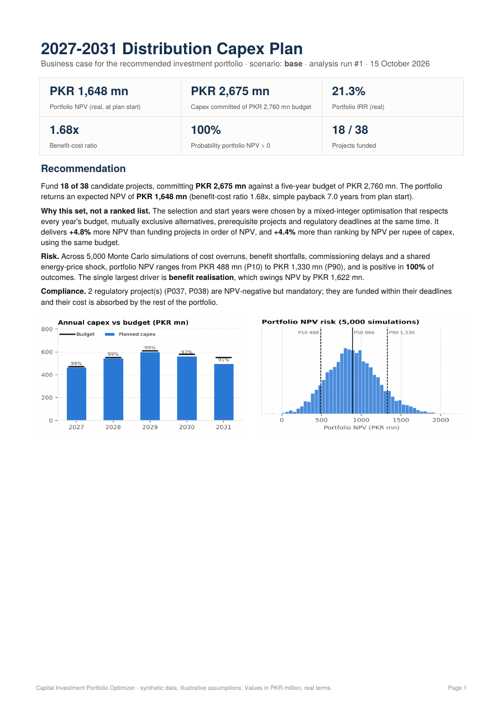
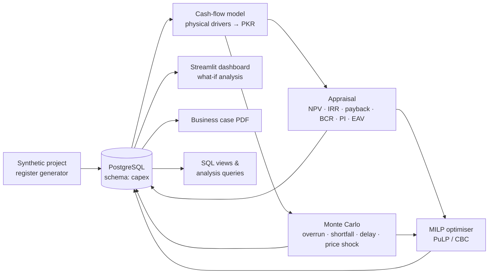
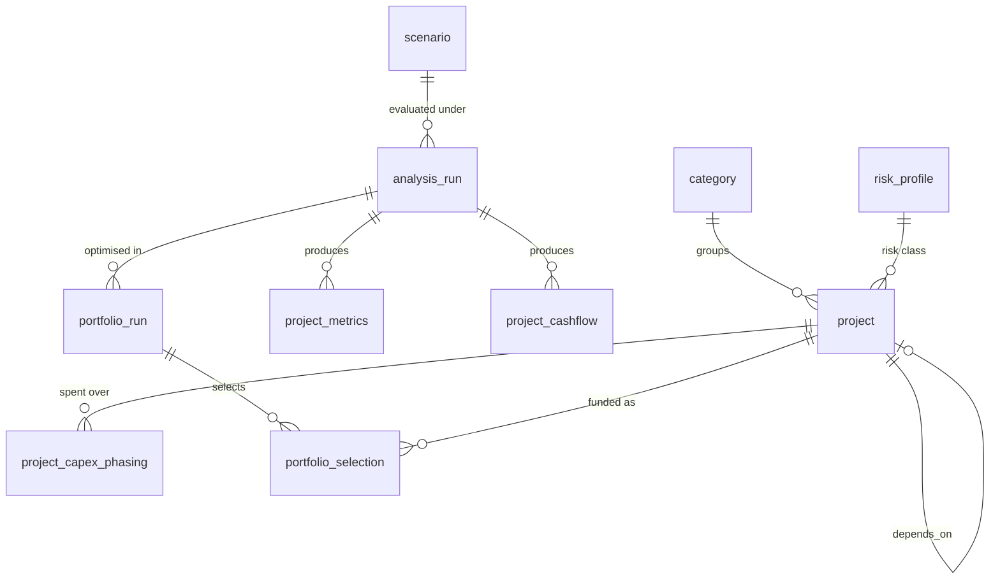

# Capital Investment Portfolio Optimizer

**[▶ Live demo](https://capex-portfolio-optimizer-nbacawq9vbvctw46ggcrxh.streamlit.app/)** · [Sample business case (PDF)](reports/sample_business_case.pdf) · [](https://github.com/malyanjamal/capex-portfolio-optimizer/actions/workflows/ci.yml)

**Which capital projects should a power distribution utility fund over the next five years, and when, to create the most value within its budget?**

This project answers that question end to end. It appraises 38 candidate network investments (NPV, IRR, payback, benefit-cost ratio), stress-tests them with Monte Carlo simulation, then uses mixed-integer optimisation to choose and schedule the portfolio. It produces an interactive dashboard and a board-style business case PDF, all on top of a PostgreSQL data model.

> All data is synthetic and every assumption is illustrative and documented. The structure mirrors a real distribution capex planning cycle: loss reduction, theft reduction, reliability, capacity and regulatory projects competing for one budget.



---

## Results (base scenario)

| | |
|---|---|
| Candidate projects | 38, totalling PKR 5,525 mn of capex |
| Five-year budget | PKR 2,760 mn (about 50% of demand) |
| **Recommended portfolio** | **18 projects, PKR 2,675 mn capex, NPV PKR 1,648 mn** |
| Portfolio IRR / benefit-cost ratio | 21.3% real / 1.68x |
| **Optimiser vs common practice** | **+4.8% NPV** vs funding in order of NPV, **+4.4%** vs ranking by NPV per rupee, with the same budget |
| Risk (5,000 simulations) | P10 PKR 488 mn · P50 PKR 886 mn · P90 PKR 1,330 mn |
| Biggest value driver | Benefit realisation (±20% swings NPV by PKR 1,622 mn) |

Findings a planner would act on:

- **A single NPV number can mislead.** One grid-station augmentation has a positive NPV of PKR 78 mn on central assumptions, but is NPV-positive in only **10%** of simulations once cost-overrun and delay risk are included. The optimiser can plan on P10 NPV to screen out such projects.
- **Ranking lists miss interactions.** The optimiser picks a cheap capacitor bank over a reconductoring project on the same feeder, re-times projects to fill each year's budget (98-99% utilisation in years 1-3), and funds regulatory projects inside their deadlines while still beating both ranking rules.
- **Enablers need to be valued with what they unlock.** Regional SCADA upgrades are NPV-negative on their own. The model evaluates them together with the automation projects that depend on them, rather than rejecting them outright.

---

## What it does



1. **Cash-flow model.** Each project's benefits come from engineering quantities, not hand-typed rupees:
   - technical losses avoided (MWh) are valued at the energy purchase cost
   - theft recovered (MWh) is valued at tariff × collection rate
   - outages avoided (MWh) are valued at the value of lost load, switchable to the utility's own lost margin
   - avoided maintenance is counted directly in PKR

   The model also handles capex phasing, benefit ramp-up, O&M costs and real benefit growth.
2. **Appraisal.** It calculates NPV, IRR (solved robustly, returning "none" when no IRR exists), simple and discounted payback, benefit-cost ratio, profitability index and equivalent annual value.
3. **Risk.** It runs a vectorised Monte Carlo simulation (5,000 runs in under a second):
   - triangular capex-overrun and benefit-realisation multipliers by risk class
   - discrete commissioning delays
   - one **shared** energy-price shock, so systematic risk does not falsely diversify away in the portfolio

   A one-at-a-time sensitivity (tornado) analysis shows which assumptions drive the result.
4. **Optimisation.** A binary choice of *which* project and *which start year*:

   $$\max \sum_{p}\sum_{s} V_p\,(1+r)^{-s}\,x_{p,s}$$

   This is subject to:
   - the annual budget in every year
   - each project funded at most once
   - mandatory projects funded within their deadlines
   - at most one of each set of mutually exclusive alternatives
   - prerequisite projects starting first

   $V_p$ can be the deterministic NPV, the Monte Carlo mean, or P10 for a risk-averse plan. Greedy NPV and greedy profitability-index rankings are solved alongside as baselines. An **efficient frontier** shows the portfolio NPV achievable at each budget level.
5. **Outputs.**
   - The dashboard lets you change the scenario, budget and assumptions and re-optimise live.
   - The business case PDF is auto-generated; there is a [sample](reports/sample_business_case.pdf) in this repo.
   - Every run is persisted in Postgres for audit and SQL analysis.

## Data model



Reference tables include `assumption` (every price and rate, with units and descriptions) and `budget`. The reporting views are `v_project_economics` (ranks by window function), `v_category_summary` and `v_portfolio_annual_capex` (budget utilisation per year). See [`sql/03_analysis_queries.sql`](sql/03_analysis_queries.sql) for example queries: running totals, optimiser-vs-heuristic differences with `FULL OUTER JOIN`, the "optimism gap" between deterministic and simulated NPV, and the present-value benefit mix by category.

---

## Quick start (Windows, VS Code, local PostgreSQL)

```powershell
# 1. Create the database (or use pgAdmin: right-click Databases → Create)
psql -U postgres -c "CREATE DATABASE capex;"

# 2. Python environment
python -m venv .venv
.venv\Scripts\Activate.ps1
pip install -r requirements.txt
pip install -e .

# 3. Connection settings: copy, then put your Postgres password in .env
copy .env.example .env

# 4. Build everything: schema → data → appraisal → Monte Carlo → optimisation → PDF
python -m capex.pipeline all

# 5. Dashboard (opens in the browser at http://localhost:8501)
streamlit run app/streamlit_app.py

# 6. Tests
pytest
```

On macOS or Linux, activate the environment with `source .venv/bin/activate` and use `cp` instead of `copy`. In VS Code, the **Run and Debug** panel has ready-made "Run full pipeline" and "Streamlit dashboard" launch configs.

**With Docker instead:** `docker compose up --build`, then open http://localhost:8501.

**Deploy a public demo:** see [`docs/DEPLOY.md`](docs/DEPLOY.md) for free hosting on Neon (PostgreSQL) and Streamlit Community Cloud.

### Individual commands

```bash
python -m capex.pipeline init-db                     # recreate schema + views (drops data)
python -m capex.pipeline seed                        # load the project register
python -m capex.pipeline analyze --scenario pessimistic --sims 10000
python -m capex.pipeline optimize --objective mc_p10 # risk-averse portfolio
python -m capex.pipeline report                      # rebuild the PDF
```

## Project structure

```
├── sql/
│   ├── 01_schema.sql            tables, keys, CHECK constraints
│   ├── 02_views.sql             reporting views
│   └── 03_analysis_queries.sql  example analytical SQL
├── src/capex/
│   ├── generator.py     synthetic project register from physical drivers
│   ├── cashflows.py     drivers → yearly cash flows
│   ├── finance.py       NPV, IRR, payback, BCR, PI, EAV
│   ├── analysis.py      project appraisal per scenario
│   ├── montecarlo.py    vectorised risk simulation
│   ├── sensitivity.py   tornado analysis
│   ├── optimizer.py     MILP + greedy baselines + efficient frontier
│   ├── report.py        executive PDF
│   ├── pipeline.py      CLI orchestration
│   └── db.py            PostgreSQL access
├── app/streamlit_app.py interactive dashboard
├── tests/               20 unit tests (finance maths, model, optimiser constraints)
└── .github/workflows/   CI: tests + full pipeline on a Postgres service
```

## Assumptions and limitations

All values are in PKR million, in real terms, discounted at a 12% real WACC. Every price and rate lives in the `assumption` table and can be changed in the dashboard. The model deliberately leaves out:

- taxes, financing structure and salvage value
- deferral effects beyond time-shifting cash flows
- correlation between projects other than the shared energy-price factor and the explicit constraints

Risk distributions are set by risk class, not estimated from historical project data. A real deployment would calibrate them from past project outturns.

## Tech

Python (pandas, NumPy, SciPy), PostgreSQL 16, SQLAlchemy and psycopg 3, PuLP with the CBC solver, Streamlit, Plotly, Matplotlib, ReportLab, pytest, Docker and GitHub Actions.
